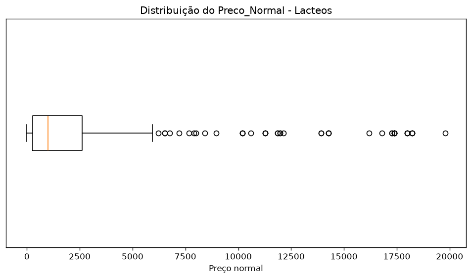
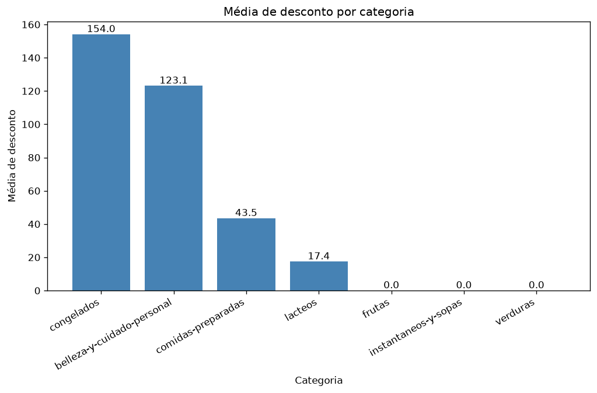
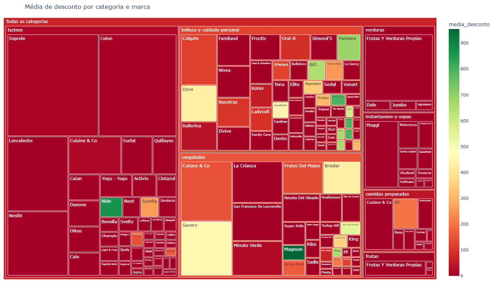

# Projeto 3 - Fundamentos da Descoberta de Dados (EBAC - Módulo 13)

Análise exploratória de uma base de produtos de um supermercado do Chile, aplicando estatística descritiva e visualização de dados.

## O que foi feito

1. Média e mediana do `Preco_Normal` por categoria, identificando as categorias com média acima/abaixo da mediana
2. Desvio padrão por categoria e análise da categoria com maior desvio (**lacteos**)
3. Boxplot do `Preco_Normal` de lacteos e identificação dos outliers (43 produtos, principalmente packs de 12 L de leite e leite em pó)
4. Gráfico de barras com a média de desconto por categoria
5. Mapa interativo (treemap) agrupando por categoria e marca, com a média de desconto

## Arquivos

- `Projeto_M13_Descoberta_de_Dados.ipynb` - notebook com o código e as análises
- `MODULO7_PROJETOFINAL_BASE_SUPERMERCADO.csv` - base de dados
- `graficos/` - imagens dos gráficos e o mapa interativo em HTML

## Gráficos

## Bibliotecas

pandas, matplotlib e plotly
